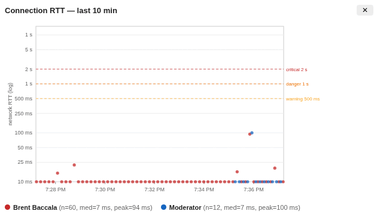

# bbb-plugin-rtt-monitor

A **moderator-only** BigBlueButton v3.0 plugin that shows a live graph of
every participant's network round-trip time (RTT) to the server, over a
rolling window (default 10 minutes).

## Demo

Moderator view, live — each dot is one `/rtt-check` sample (~every 10 s); the
time axis scrolls left as the window advances and old samples drop off. Here
two participants sit at a healthy ~7 ms; a degraded client would climb toward
the dashed warning / danger / critical reference lines, standing out against
the others:



## Why

A moderator currently has no easy way to see, live, that a specific
participant's connection is degrading. BBB's built-in "Connection status"
modal lists users who went *unstable* but shows no RTT trend. This panel
plots per-user RTT over time so the moderator can immediately see
"Bruce's line is spiking, everyone else is flat — it's his connection."

The RTT probe (`/bigbluebutton/rtt-check`, every ~10 s) runs regardless of
audio/video/screenshare, so the monitor works even in a remote-desktop-only
session.

## How it works

- **Launcher**: an entry in the options ("...") menu, top-right. It is
  registered *only* when the current user's role is `MODERATOR`.
- **Data**: a custom GraphQL subscription on the `user_connectionStatusHistory`
  view, joined with the `user` relationship for name/role:

  ```graphql
  subscription ModeratorRttHistory {
    user_connectionStatusHistory(order_by: { statusUpdatedAt: asc }) {
      userId
      networkRttInMs
      status
      statusUpdatedAt
      user { name role }
    }
  }
  ```

  The view's Hasura `select_permission` (role `bbb_client`) returns **all**
  meeting users' rows to a moderator (`meetingId == X-Hasura-ModeratorInMeeting`)
  but only own-rows to a viewer. So moderator-only visibility is enforced
  **server-side**, not just in the UI — a non-moderator who runs the same
  subscription by hand sees only their own RTT.

- **Chart**: a movable floating window with a per-user scatter (dots, not
  connected lines — isolated spikes read better as points). Log y-axis
  (`10 ms … 15 s`), one color per user, legend with name + median + peak,
  and the BBB `public.stats.rtt` thresholds drawn as reference lines:
  warning 500 ms, danger 1 s, critical 2 s.

- **Charting approach**: a **hand-rolled SVG scatter** (no chart library).
  The plot is a log-scaled scatter with a handful of reference lines — too
  simple to justify a dependency. This keeps the bundle small (React + the
  SDK only) and avoids pulling in D3/recharts/uPlot.

- **Rolling buffer**: the server retains only the last `public.stats.lastEntriesCap`
  samples per user-session (default **20** ≈ 3.3 min at 10 s cadence). The
  panel keeps its **own** client-side rolling buffer, merging each
  subscription push and deduping by `(userId, statusUpdatedAt)`, so the
  window grows toward the full 10 min while the panel stays open — and
  degrades gracefully (shows however much history exists) on deployments
  where the cap was left at its default.

## Install

Download the latest `.deb` from the apt repo's package directory —
<http://u24.freesoft.org/jammy-300/pool/main/b/bbb-plugin-rtt-monitor/> — then
install it and restart so bbb-web picks up the new plugin manifest (a running
meeting won't load a newly installed plugin until BBB restarts or a new meeting
starts):

```bash
sudo dpkg -i bbb-plugin-rtt-monitor_<ver>_all.deb
sudo bbb-conf --restart
```

### From the apt repo

This plugin and related BigBlueButton packages are also hosted in an apt repo.
Add it once, then install and upgrade with `apt`:

```bash
# trust the repo's signing key
curl -fsSL http://u24.freesoft.org/jammy-300/freesoft.asc \
  | sudo gpg --dearmor -o /usr/share/keyrings/freesoft.gpg

# register the repo
echo 'deb [signed-by=/usr/share/keyrings/freesoft.gpg] http://u24.freesoft.org/jammy-300 bigbluebutton-jammy main' \
  | sudo tee /etc/apt/sources.list.d/freesoft.list

sudo apt update
sudo apt install bbb-plugin-rtt-monitor
sudo bbb-conf --restart
```

## Server configuration

### 10-minute window: bump `lastEntriesCap`

For the default 10-minute window to be populated *immediately* on open
(rather than filling in over the first ~10 min the panel is open), raise the
history cap, `public.stats.lastEntriesCap`. A stock BBB `settings.yml` ships
the `stats:` block **without** this key (the schema default is 20 ≈ 3.3 min
at the ~10 s probe cadence).

Set it in the client-settings **override** file rather than editing the
packaged `settings.yml` — on BBB 3.0 (verified on **3.0.29**) that is:

```
/etc/bigbluebutton/bbb-html5.yml
```

This file is deep-merged over the packaged settings, so add only the key you
want under the existing `public:` block (create the `stats:` child if it
isn't already there):

```yaml
public:
  stats:
    lastEntriesCap: 64   # ≈ 10.5 min at the ~10 s probe cadence
```

The history-trim trigger in BBB's schema
(`update_user_connectionStatus_trigger_func`) reads this per-meeting from
`meeting_clientSettings.clientSettingsJson->'public'->'stats'->'lastEntriesCap'`
and keeps only the most-recent N rows per `(meetingId, userId, sessionToken)`
via `OFFSET lastEntriesCap`. The value is captured at meeting-creation time,
so apply with a restart that re-reads client settings, then start a **new**
meeting:

```bash
sudo bbb-conf --restart        # re-reads client settings; restarts bbb-web, akka, graphql
```

The plugin works with **whatever cap is set** (or none — it then shows
however much history exists). The bump only changes how much backfill is
visible the instant the panel opens; the client-side buffer extends the
window past the cap while the panel stays open regardless.

### Registering the plugin

The Debian package's `postinst` adds the plugin's manifest URL to
`pluginManifests=` in `/etc/bigbluebutton/bbb-web.properties` automatically.
Plugin manifests are read by **bbb-web** at meeting-creation time, so an
existing meeting won't pick up a newly installed plugin — end the meeting and
start a new one, or run `bbb-conf --restart`.

## Settings

Optional plugin settings (set in `/etc/bigbluebutton/bbb-html5.yml` under the
plugin's entry; read by bbb-apps-akka at startup, so an akka restart is needed
to change them):

| Setting         | Type   | Default | Meaning                                                                                          |
|-----------------|--------|---------|--------------------------------------------------------------------------------------------------|
| `windowMinutes` | number | `10`    | Width of the rolling time window the chart shows. Samples older than this scroll off the left edge. (The probe cadence itself is fixed by BBB at ~10 s and is not configured here.) |

## Build

```bash
git commit ...        # commit FIRST (see note below)
npm install
npm run build         # → dist/RttMonitor-<hash>.js, dist/manifest.json, dist/locales/
```

**Why commit first?** The build embeds the short git commit hash in the bundle
filename (`RttMonitor-<hash>.js`) and writes that name into `manifest.json`.
That hash is what makes the URL change between releases, so browsers and any
CDN fetch the new bundle instead of a stale cached copy. `webpack` reads the
hash from `git rev-parse --short HEAD`, which only advances when you commit —
so if you build with uncommitted changes, the new code ships under the
*previous* release's filename and clients keep serving the old cached bundle.

This only matters when you've **changed the code**. Rebuilding an unchanged
checkout is fine without a new commit — the current commit's hash already
matches what's deployed, so there's nothing new to cache-bust.

## Package

```bash
dpkg-buildpackage -us -uc -b      # builds bbb-plugin-rtt-monitor_<ver>_all.deb
```
